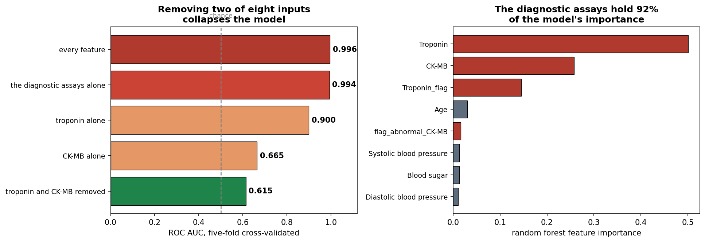
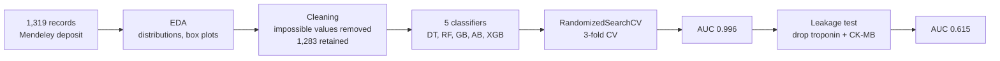

<picture>
  <source media="(prefers-color-scheme: dark)" srcset="assets/visual-abstract-dark.svg">
  
</picture>

<h1 align="center">When 99% Accuracy Means Nothing</h1>

<p align="center">
  Target leakage in a heart attack dataset, found and measured
</p>

<p align="center">
  
  
  
  
  
</p>

<p align="center">
  <a href="#the-finding">The finding</a> &nbsp;·&nbsp; <a href="#why-this-is-leakage">Why</a> &nbsp;·&nbsp; <a href="#how-it-was-measured">How</a> &nbsp;·&nbsp; <a href="#what-this-dataset-can-support">What it supports</a> &nbsp;·&nbsp; <a href="#quick-start">Quick start</a>
</p>

---

## At a glance

| **0.996** | **0.615** | **0.604** | **0.882** | **91.9%** |
|:---:|:---:|:---:|:---:|:---:|
| AUC with troponin and CK-MB | AUC without them | majority-class baseline | accuracy from one troponin cut-off, no model | feature importance held by the two assays |

> **Take-home:** this dataset's headline accuracy comes from target leakage. Troponin and
> CK-MB are not predictors of a heart attack, they are the blood tests it is diagnosed
> with. A model given them is recovering the label from the measurement that defined it.
> Remove them and the model drops to the level of guessing the commoner class.

## The finding

A tuned random forest on all eight inputs reaches **0.996 ROC AUC** and 98.7% accuracy.
That number is real and reproducible. It is also meaningless as a prediction claim.

| Feature set | AUC | Accuracy |
|---|:---:|:---:|
| Every feature | 0.996 | 0.987 |
| **Troponin and CK-MB removed** | **0.615** | **0.635** |
| The two assays alone | 0.994 | 0.981 |
| Troponin alone, single cut-off, no model at all | 0.900 | 0.882 |
| Majority-class baseline | 0.500 | 0.604 |

Three things follow.

**Removing two of eight inputs collapses the model.** AUC falls from 0.996 to 0.615, and
accuracy to 0.635 against a 0.604 baseline. On routine observations, age, sex, heart rate,
blood pressure and blood sugar, the model is barely distinguishable from always answering
"heart attack".

**The two assays alone match the full model.** Everything else contributes nothing once
they are present.

**A single threshold beats the pipeline.** Thresholding troponin at 0.015 ng/mL, with no
model, no tuning and no cross-validation, reaches 0.882 accuracy. Five classifiers and a
RandomizedSearchCV over 50 configurations do not improve on one comparison.



## Why this is leakage

Troponin is a protein released into the blood when heart muscle is damaged. The Fourth
Universal Definition of Myocardial Infarction defines the event as a **rise and fall of
cardiac troponin above the 99th percentile of a reference population**, together with
clinical evidence of ischaemia. CK-MB serves the same diagnostic role, less specifically.

So troponin is not a risk factor measured before the event. It is the measurement the
diagnosis is made from. A model predicting the diagnosis from troponin is predicting a
label from the test that produced it, which is **target leakage**.

The notebook makes this concrete. It builds a feature `Troponin_flag` at 0.04 ng/mL and
documents that this is the clinical decision threshold. A feature constructed from the
diagnostic cut-off is a restatement of the diagnosis, not a predictor of it.

Standard safeguards do not catch this. The train and test split is correct, the
cross-validation is correct, and the tuning is correct. Leakage of this kind lives in the
*meaning of the columns*, not in the fitting procedure, so no resampling scheme detects
it. Only knowing what the measurements are does.

## How it was measured

- **Five-fold cross-validation** rather than a single split, so the comparison does not
  depend on one partition.
- **AUC computed from predicted probabilities**, not from hard class labels. AUC on 0/1
  predictions discards the ranking it is meant to measure and collapses toward balanced
  accuracy.
- **Average precision reported alongside AUC**, since the classes are imbalanced at 60/40.
- **A majority-class baseline**, so "0.635 accuracy" is read against the 0.604 that
  predicting the commoner class achieves for free.
- **A model-free control**: troponin used directly as a score, and the best single cut-off
  found by sweeping. If a threshold matches the model, the model has learned the threshold.

## What this dataset can support

**It cannot support** a claim of predicting heart attacks from routine clinical
observations. The honest figure for that question is AUC 0.615, which is not clinically
useful.

**It can support** a demonstration that the diagnostic assays are doing all the work. That
is a real, checkable finding, and it is what this repository now reports.

**What would make the prediction question answerable:** features recorded *before* the
diagnostic workup, such as presenting symptoms, ECG findings, history, medications and
time from symptom onset. Troponin at admission could legitimately predict a *later*
outcome such as mortality or reinfarction, since that outcome is not defined by the assay.

## Pipeline



## Data

| | |
|---|---|
| **Source** | [Mendeley Data, doi:10.17632/wmhctcrt5v.1](https://data.mendeley.com/datasets/wmhctcrt5v) |
| **Collected** | Zheen Hospital, Erbil, Iraq, January to May 2019 |
| **Size** | 1,319 records, 8 inputs and 1 label; 1,283 retained after cleaning |
| **Classes** | 60.4% positive |
| **Fetch** | `python scripts/fetch_data.py` |

The notebook previously read `/kaggle/input/heart-attack-dataset/Medicaldataset.csv`,
a path that only resolves inside a Kaggle kernel. It now reads `data/Medicaldataset.csv`,
fetched from the original open deposit by the script above, which also checks the row
count against the publication.

## Quick start

```bash
pip install scikit-learn xgboost pandas seaborn matplotlib joblib
python scripts/fetch_data.py
jupyter notebook heart_attack_classification_Project.ipynb
```

The notebook runs top to bottom in a fresh kernel. Three defects that previously prevented
that are fixed: `RandomizedSearchCV` and `joblib` were used without being imported, and a
superseded draft cell referenced a variable defined later in the notebook. The AdaBoost
grid now adapts to the installed scikit-learn, since version 1.6 removed the `algorithm`
argument that the old pin worked around.

## Repository structure

```
├── heart_attack_classification_Project.ipynb   # EDA, cleaning, benchmarking, leakage test
├── scripts/fetch_data.py                       # downloads the dataset from Mendeley
├── data/Medicaldataset.csv                     # created by the fetch script
├── assets/
│   ├── visual-abstract-*.svg                   # visual abstract, light and dark
│   └── figures/                                # exported from notebook outputs
└── LICENSE
```

## Provenance

Self-directed project, originally completed as a systems biology project at Heidelberg
University and subsequently reworked around the leakage finding. Code was written with AI
assistance and has been reviewed and validated by me.

## License

Released under the [MIT License](LICENSE).
