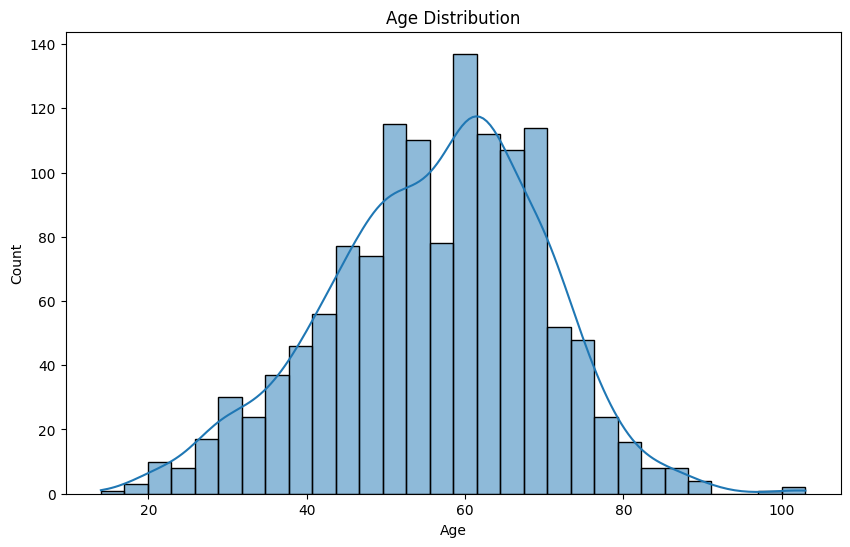
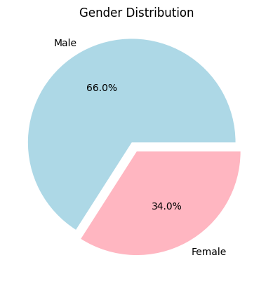
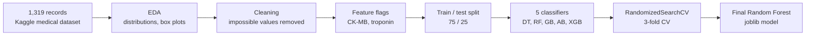

<picture>
  <source media="(prefers-color-scheme: dark)" srcset="assets/visual-abstract-dark.svg">
  
</picture>

<h1 align="center">Heart Attack Prediction with Machine Learning</h1>

<p align="center">
  A clinical risk classifier built from routine biomarkers, with careful data cleaning, five benchmarked tree models and hyperparameter tuning
</p>

<p align="center">
  
  
  
  
  
</p>

<p align="center">
  <a href="#overview">Overview</a> &nbsp;·&nbsp; <a href="#results">Results</a> &nbsp;·&nbsp; <a href="#pipeline">Pipeline</a> &nbsp;·&nbsp; <a href="#interpretation-and-limitations">Interpretation</a> &nbsp;·&nbsp; <a href="#quick-start">Quick start</a>
</p>

---

## At a glance

| **1,283** | **8** | **5** | **99.07%** | **99.49%** |
|:---:|:---:|:---:|:---:|:---:|
| patients after cleaning | clinical features | classifiers benchmarked | test accuracy (Random Forest) | test precision (Random Forest) |

> **Take-home:** a tuned Random Forest reaches 99.07% accuracy on held-out patients, and the saved model scores new patients instantly. However, troponin and CK-MB are themselves diagnostic markers of heart muscle damage, so validation on an independent cohort is the natural next step.

## Skills demonstrated

| Area | Evidence in this repository |
|---|---|
| **Exploratory data analysis** | Distribution and box plots for every clinical variable, plus missing-value and duplicate checks |
| **Clinical data cleaning** | Rule-based removal of physiologically impossible readings and clinically motivated CK-MB and troponin flags |
| **Machine learning** | Decision tree, random forest, gradient boosting, AdaBoost and XGBoost classifiers benchmarked on a held-out test set |
| **Model selection** | RandomizedSearchCV with 3-fold cross-validation, evaluated with accuracy, F1, precision, recall and ROC AUC |
| **Deployment** | Model persistence with joblib and a risk-scoring function for new patients |
| **Python** | pandas, NumPy, seaborn, matplotlib, scikit-learn and XGBoost |

## Overview

Heart attacks (myocardial infarctions) need to be recognized quickly. This project builds a machine learning classifier that predicts whether a patient is having a heart attack from eight routine clinical measurements, and it then benchmarks five tree-based models to find the most reliable one. It was completed as a systems biology project at Heidelberg University.

**Features used**

| Feature | Description |
|---|---|
| Age, Gender | Patient demographics |
| Heart rate | Beats per minute |
| Systolic and diastolic blood pressure | mmHg |
| Blood sugar | mg/dL |
| CK-MB | Creatine kinase myocardial band, a marker of heart muscle damage |
| Troponin | Cardiac troponin, the most specific blood marker of heart muscle injury |
| `flag_abnormal_CK-MB` | Engineered flag, CK-MB above 50 (about 10 times the upper reference limit) |
| `Troponin_flag` | Engineered flag, troponin above 0.04 ng/mL (the 99th percentile of a healthy population) |

## Results

Performance on the held-out test set (321 patients):

| Model | Accuracy | F1 | Precision | Recall | ROC AUC |
|---|:---:|:---:|:---:|:---:|:---:|
| **Random Forest (tuned)** | **99.07%** | **99.07%** | **99.49%** | **98.99%** | **99.09%** |
| XGBoost | 98.75% | 98.75% | 98.99% | 98.99% | 98.68% |
| Gradient Boosting | 98.75% | 98.75% | 98.99% | 98.99% | 98.68% |
| AdaBoost | 98.44% | 98.44% | 98.50% | 98.99% | 98.27% |
| Decision Tree | 98.44% | 98.44% | 98.99% | 98.49% | 98.43% |

The final Random Forest uses `n_estimators=200`, `max_depth=10` and `min_samples_split=2`. The ROC AUC values in this table are computed from predicted class labels.

In addition, the ROC cell trains all five tuned models with a fixed `random_state`, computes each AUC from predicted probabilities with `roc_auc_score`, and plots the curves on one figure (`auc.png`). Its earlier output showed a hard-coded AUC label, so that output has been cleared, and running the notebook regenerates the figure from the test set.

<p>
  
  
</p>

## Pipeline



The core steps, as implemented in the notebook:

```python
import pandas as pd
from sklearn.model_selection import train_test_split
from sklearn.ensemble import RandomForestClassifier

df = pd.read_csv("Medicaldataset.csv")                        # 1,319 records

# Remove physiologically impossible readings
df = df[df["Heart rate"] < 200]
df = df[(df["Blood sugar"] >= 50) & (df["Blood sugar"] <= 600)]
df = df[(df["CK-MB"] >= 0) & (df["CK-MB"] <= 200)]

# Clinically motivated flags
df["flag_abnormal_CK-MB"] = (df["CK-MB"] > 50).astype(int)
df["Troponin_flag"] = (df["Troponin"] > 0.04).astype(int)
df["heart_attack"] = (df.pop("Result") == "positive").astype(int)

X, y = df.drop(columns="heart_attack"), df["heart_attack"]
X_train, X_test, y_train, y_test = train_test_split(X, y, test_size=0.25, random_state=42)

model = RandomForestClassifier(n_estimators=200, max_depth=10, min_samples_split=2)
model.fit(X_train, y_train)                                   # 99.07% test accuracy
```

## Interpretation and limitations

- **Why the scores are so high:** troponin and CK-MB are the biomarkers clinicians use to diagnose heart muscle damage, so the label is closely tied to two of the inputs. Consequently, the near-perfect accuracy reflects how informative these markers are rather than a hidden pattern in the other features.
- **Single dataset:** all models were trained and tested on one public dataset, so performance on a different hospital population is unknown.
- **Perfect training scores:** tree models fit the training set perfectly, which makes the held-out test set and cross-validation essential for judging generalization.
- **Next steps:** external validation, feature-importance and SHAP analysis, and a version of the model without troponin and CK-MB to measure how much the other features contribute.

## Quick start

```bash
pip install "scikit-learn<1.6" xgboost pandas seaborn matplotlib joblib
jupyter notebook heart_attack_classification_Project.ipynb
```

The version pin keeps the tuning grid working, since it includes the AdaBoost `SAMME.R` option that newer scikit-learn releases removed. Running the notebook saves the ROC comparison as `auc.png` and the final model as `rf_heart_model.pkl`, which the last cells load to score new patients.

## Repository structure

```
├── heart_attack_classification_Project.ipynb   # EDA, cleaning, benchmarking, tuning and scoring
├── assets/
│   ├── visual-abstract-*.svg                   # Visual abstract (light and dark)
│   └── figures/                                # Figures exported from the notebook outputs
└── LICENSE
```

## License

Released under the [MIT License](LICENSE).
